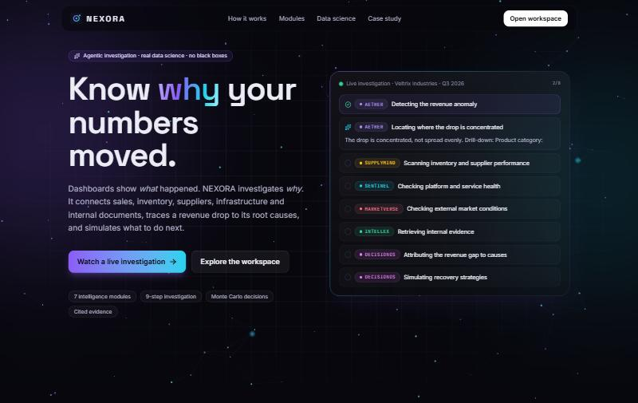
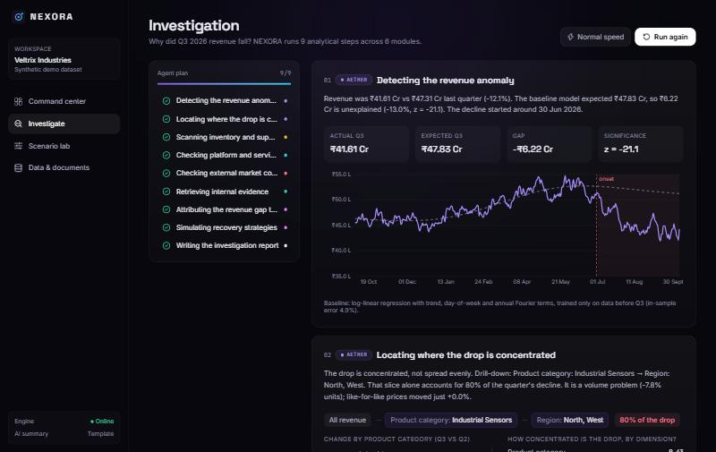
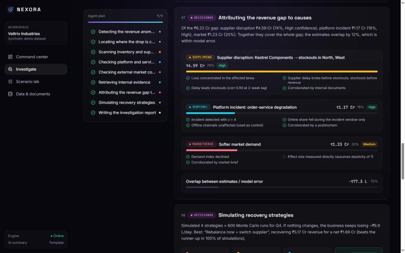
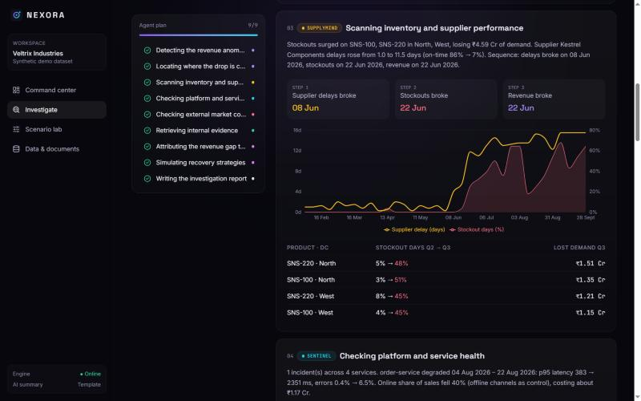
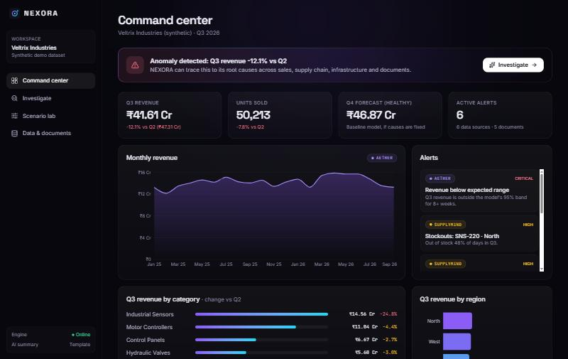

<div align="center">

# NEXORA

**Know *why* your numbers moved.**

An agentic investigation platform that traces a business metric drop to its root causes,
across sales, inventory, suppliers, infrastructure and internal documents, then simulates what to do next.



</div>

---

## The problem

Dashboards tell you **what** happened: *“Q3 revenue fell 12%.”*
They don’t tell you **why**. The answer usually spans teams: procurement sees a late supplier, operations sees stockouts,
engineering sees an incident ticket, finance sees a number. Each team holds one link of the chain.

NEXORA connects the links. It runs a nine-step investigation that detects the anomaly, finds where it is concentrated,
scans operational signals for causes, retrieves corroborating documents, attributes the loss to each cause with a confidence
level, and simulates recovery strategies with uncertainty ranges.

## What it found (demo case)

The demo company, *Veltrix Industries*, is a **fictional manufacturer** whose 21 months of operations are generated by a
mechanistic simulation (demand → inventory → fulfilment). Two incidents are planted in Q3 2026, and **NEXORA is never told
about them**:

| Planted in the simulator | What NEXORA reported |
|---|---|
| Kestrel Components’ deliveries to the North & West DCs slip from ~1 to ~12 days late from mid-June | Drill-down isolated **Industrial Sensors → North & West** (80% of the drop). Change-point order: **supplier delays (8 Jun) → stockouts (22 Jun) → revenue (week of 22 Jun)**. Delay leads stockouts with corr 0.93 at a 2-week lag. **₹4.59 Cr, 74% of the gap, High confidence** |
| `order-service` degrades 4–22 Aug (p95 latency, errors) | Detected a 19-day incident (z > 4); difference-in-differences against offline channels shows online share −40%. **₹1.17 Cr, 19%, High confidence** |
| Market demand softens ~3% (a red herring) | Correctly sized as a minor headwind (**~20%, Medium confidence**). Pricing ruled out (like-for-like price change 0.0%) |

Recommendation: *rebalance stock now and switch the affected lanes to the pre-qualified alternate supplier*, recovering
**≈₹5.2 Cr** of Q4 revenue for a net **≈₹1.7 Cr** after costs (P10–P90 ₹1.1–2.2 Cr), better than the runner-up in 100% of 600 simulations.

These outcomes are locked in by an end-to-end test suite (`backend/tests`).

## How it works

```
                ┌───────────────────────────── NEXORA orchestrator (9 steps) ─────────────────────────────┐
 sales ─────────┤ 1 AETHER      baseline model → anomaly + onset                                          │
 inventory ─────┤ 2 AETHER      concentration scoring → greedy drill-down, price-volume split             │
 shipments ─────┤ 3 SUPPLYMIND  stockout hotspots, supplier delays, change points, lead-lag correlation   │
 service logs ──┤ 4 SENTINEL    incident detection (z-scores) → revenue impact via diff-in-diff           │──► report
 market index ──┤ 5 MARKETVERSE external demand context                                                   │
 documents ─────┤ 6 INTELLEX    TF-IDF retrieval of cited evidence (postmortems, scorecards, contracts)   │
                │ 7 DECISIONOS  attribution of the gap to causes with evidence checklists → confidence    │
                │ 8 DECISIONOS  Monte Carlo simulation of recovery strategies (P10/P50/P90)               │
                │ 9 NEXORA      report (template writer; optional Claude summary grounded in the numbers) │
                └──────────────────────────────────────────────────────────────────────────────────────────┘
```

### Not an LLM wrapper

Every number is computed by a statistical method; nothing is generated.

| Technique | Used for |
|---|---|
| Log-linear ridge regression with trend, day-of-week and Fourier seasonality | Expected revenue (“what should have happened”), quarter-level z-score |
| Concentration scoring + greedy drill-down | Finding where a drop is *disproportionate*, not just largest |
| Price–volume decomposition (mix-adjusted) | Ruling pricing in or out |
| Sustained change-point detection | Ordering events in time (cause before effect) |
| Lagged cross-correlation | Testing whether a signal *leads* the outcome |
| Difference-in-differences | Costing a platform incident with offline channels as control |
| TF-IDF retrieval | Citing internal evidence |
| Monte Carlo simulation | Ranking strategies under uncertainty in demand, loss severity and onboarding time |

An optional language-model layer (Claude, via the official Anthropic SDK) only rewrites the headline and summary,
using the findings JSON; if no API key is set, or the call fails, the deterministic template writer is used.

## Screenshots

| Live investigation | Root-cause attribution |
|---|---|
|  |  |

| Supply-chain evidence | Command center |
|---|---|
|  |  |

## Run it

### Option A: one command with Docker

```bash
docker compose up --build
```

Open http://localhost:8000.

### Option B: local development (lighter on RAM)

Backend (Python 3.11+):

```bash
cd backend
python -m venv .venv
.venv\Scripts\activate          # macOS/Linux: source .venv/bin/activate
pip install -r requirements.txt
python -m nexora.data.generate   # creates the synthetic dataset
uvicorn nexora.api:app --port 8000
```

Frontend (Node 20+), in a second terminal:

```bash
cd frontend
npm install --legacy-peer-deps
npm run dev
```

Open http://localhost:5173.

Run the investigation from the command line, or run the tests:

```bash
cd backend
python scripts/run_investigation.py
python -m pytest
```

Optional: copy `.env.example` to `backend/.env` and set `ANTHROPIC_API_KEY` to let Claude write the report summary.

## Project structure

```
backend/
  nexora/data/generate.py      mechanistic simulator for the synthetic company (+ internal documents)
  nexora/engine/anomaly.py     AETHER: baseline model, anomaly detection
  nexora/engine/drivers.py     AETHER: concentration scoring, drill-down, price-volume
  nexora/engine/signals.py     SUPPLYMIND / SENTINEL / MARKETVERSE scanners
  nexora/engine/retrieval.py   INTELLEX: document retrieval
  nexora/engine/scenarios.py   DECISIONOS: Monte Carlo strategy simulation
  nexora/engine/investigation.py   the 9-step orchestrator
  nexora/engine/narrative.py   report writer (template + optional Claude)
  nexora/api.py                FastAPI: REST + Server-Sent Events streaming
  tests/                       end-to-end tests
frontend/                      React + TypeScript + Tailwind + Motion + Recharts
Dockerfile, docker-compose.yml single-container build (API serves the built site)
```

## Roadmap

- **CYBERPULSE**: authentication-anomaly detection and threat correlation as a fourth evidence source
- Connectors for real sources (PostgreSQL, CSV upload, Prometheus) instead of the simulator
- Bayesian structural time series for the baseline; formal causal-graph attribution (Shapley over causes)
- Scheduled monitoring that opens an investigation automatically when a KPI leaves its band
- Scale-out path: Kafka for event ingestion, a feature store, and an orchestration service

## Honest limitations

- The data is synthetic. The simulator is mechanistic, so causal structure is realistic, but it is still a model of a company.
- The market effect assumes a demand elasticity of 1; NEXORA labels that cause *Medium* confidence for that reason.
- Cause estimates can overlap slightly (here they sum to ~112% of the gap); the report says so rather than forcing them to 100%.

---

Built by **Anshika Chaturvedi**.
